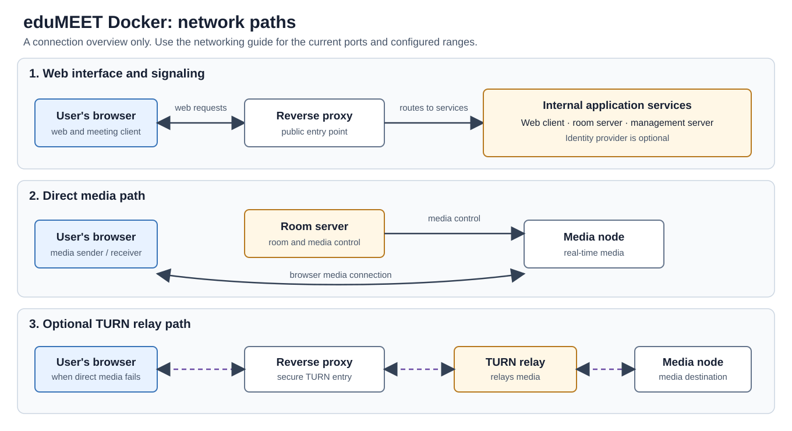

#  full Docker deployment

This repository runs [eduMEET](https://github.com/edumeet/edumeet) with a
management server and optional login. For a smaller setup without management
or login, use the [minimal deployment](https://github.com/edumeet/edumeet#installation).
Images are published on [Docker Hub](https://hub.docker.com/u/edumeet).

## Getting started

- 
  
  
  [Install and start](docs/installation.md) — prerequisites, configuration and architecture
- [Networking](docs/networking.md) — firewall ports, addresses and NAT
- 
  [Certificates](docs/certificates.md) — Let's Encrypt, local HTTPS and HSTS
- 
  
  [Authentication](docs/authentication.md) — managed rooms, OIDC and proxy settings
- 
  
  [Operations](docs/operations.md) — logs, backups, troubleshooting and uninstall
- 
  
  
  
  [Meetings and calendar invitations](docs/meetings.md)
- 
  [Development with Docker](docs/development.md)
- [Documentation maintenance](https://github.com/edumeet/edumeet#documentation)
- [Changelog](https://github.com/edumeet/edumeet/blob/main/CHANGELOG.md)

## Firewall ports and recommendations
See [networking](docs/networking.md) for the public and restricted ports,
addresses and NAT configuration.

