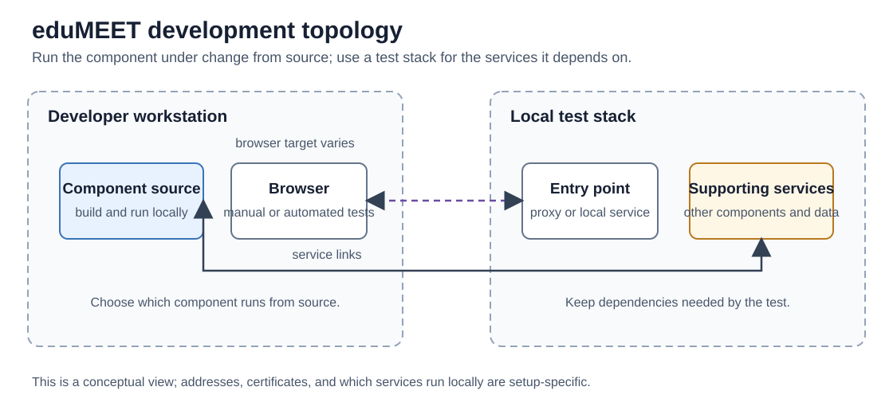

# Development with the full Docker deployment

To run eduMEET components from source, see the
[developer setup guide](https://github.com/edumeet/edumeet/blob/main/DEVELOPMENT.md)
and [VS Code guide](https://github.com/edumeet/edumeet/blob/main/DEVELOPMENT-VSCODE.md).
This page covers building components in the full Docker setup.

## Build images

To build the configured component images:

```bash
docker compose build --no-cache
```

To build one component instead, for example the room server:

```bash
docker compose build --no-cache edumeet-room-server
```

For local development, components can also run outside Docker and be connected
to the stack. With self-signed development certificates, the browser may need
to accept certificates for both the website and room-server connection.



The diagram is conceptual; ports and addresses depend on the component and
setup being tested. See [networking](networking.md) for the full deployment's
firewall ports and address/NAT guidance.

## Inspect the database

For the default database and user, open a PostgreSQL shell:

```bash
docker compose exec edumeet-db psql -U edumeet -d edumeet
```

In the shell, `\dt` lists tables and `\q` exits. Use the configured user and
database names if they differ. See [operations](operations.md#backup-and-restore)
before making changes to stored data.
