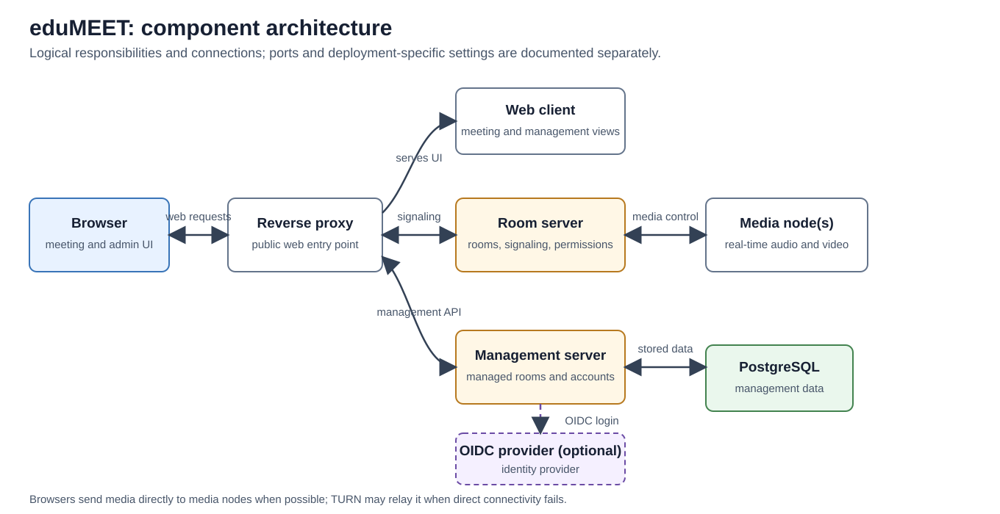

# Install the full Docker deployment

This deployment includes the client, room server, media node, management server,
PostgreSQL, Nginx, coturn and Keycloak. Login is optional. For the separate
deployment without management or login, see the
[minimal deployment guide](https://github.com/edumeet/edumeet#installation).
**Production warning:** the bundled Keycloak is for demonstration only; do not
use it as your production user database. See the
[authentication guide](authentication.md#production-warning) before configuring
login.

These instructions describe the current `main` branch. Check the configuration
for the version you deploy.

## Before you start

- Install Docker with Compose v2, curl, OpenSSL, `jq` and `ack`. On Debian or
  Ubuntu, `sudo apt install jq ack` installs the latter two; see the
  [Docker installation guide](https://docs.docker.com/engine/install/debian/)
  for Docker and Compose.
- Use two distinct domain names pointing to the server's public IP: one for the
  website and one for TURN. The existing recommendation is an 8-core server
  with 8 GB RAM, 100 GB storage and a 1 Gb/s network connection.
- Check the [firewall and NAT requirements](networking.md).

## Configure

```bash
git clone https://github.com/edumeet/edumeet-docker.git
cd edumeet-docker
./utils/run-me-first.sh
```

The interactive script requests domain names and administrator credentials,
generates secrets and a media-node certificate, and prepares configuration.
Review `.env` and the files in `configs/` before starting. The script can
modify existing configuration and secrets; back them up before rerunning it.

The script closes the installation directory to the other accounts of the host
(`chmod go-rwx .`) and `.env` to everyone but its owner. Keep it that way: see
[files with secrets](operations.md#files-with-secrets).

If the server is behind NAT, verify `LISTEN_IP`, `LOCAL_IP` and `EXTERNAL_IP`
instead of relying on automatically detected values. See
[networking](networking.md#addresses-and-nat). If you change `LISTEN_IP` after
running the setup script, regenerate the media-node certificate as described
there before starting the services.

## Set up certificates and start

Follow [certificates](certificates.md) to set up a trusted production
certificate or local HTTPS for testing. The included development script creates
a self-signed certificate, which browsers do not trust. For the included Let's
Encrypt flow, after DNS and firewall setup:

```bash
./utils/gen_cert.sh
docker compose up -d
docker compose ps
```

Open `https://<main-domain>/` and join the same room from two browsers or
devices. Check that they can hear and see each other. The management UI is at
`https://<main-domain>/mgmt-admin`; configure an identity provider as described
in [authentication](authentication.md) if login is needed.

For service status, logs, backups and troubleshooting, see
[operations](operations.md).

## Architecture

The [client](https://github.com/edumeet/edumeet-client) provides the web
interface, the [room server](https://github.com/edumeet/edumeet-room-server)
handles signaling, the [media node](https://github.com/edumeet/edumeet-media-node)
handles audio and video, and the
[management server](https://github.com/edumeet/edumeet-management-server)
provides managed rooms and authentication. Nginx connects the public endpoints
to the services.



The diagram shows component responsibilities and connections. See the
networking and authentication guides for deployment-specific ports and
identity-provider settings.
