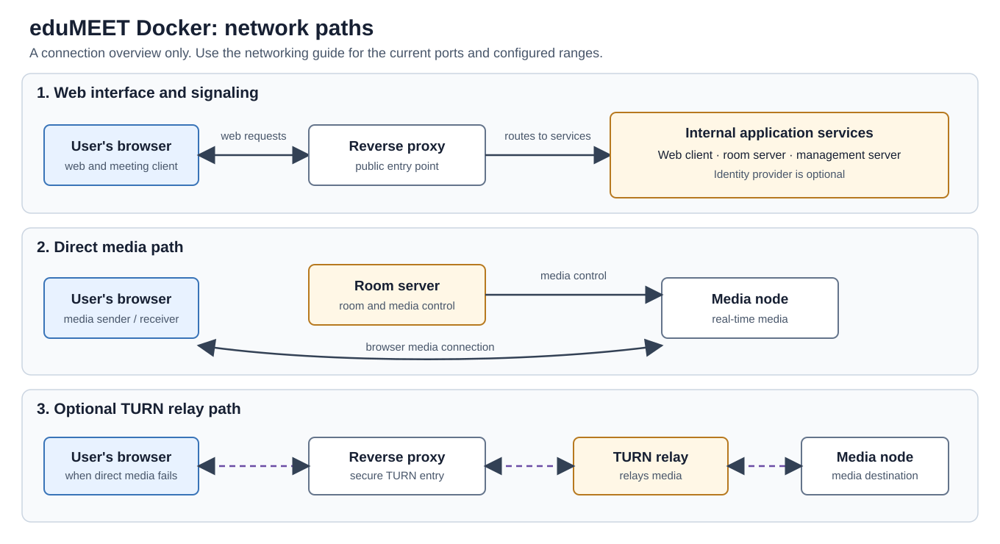

# Full Docker deployment: networking

This guide describes the default [edumeet-docker](../README.md) Compose setup.
For the [minimal deployment](https://github.com/edumeet/edumeet#prerequisites),
check its own firewall and TURN guidance.

## Public firewall

Allow these ports through the server or cloud firewall and, when applicable, the
NAT router:

| Port(s) | Protocol | Purpose |
| --- | --- | --- |
| 80 | TCP | HTTP redirect and HTTP certificate validation; optional if neither is used |
| 443 | TCP | HTTPS, signaling and TURN over TLS |
| 40000-40249 | TCP and UDP | Default media-node range |
| 50000-60000 | UDP | Default coturn relay range; see the note below |

Change the firewall rules if you change the configured ranges. Local Compose
overrides can also change the ports, so check the configuration you actually
deploy. A UDP rule does not also permit TCP, or vice versa.

The relay range is used between coturn and the media node, not for the
browser's TURN-over-TLS connection. In the default setup both services share
the host, so relay traffic may stay internal. Allowing the range publicly is
a conservative recommendation; whether it is needed depends on routing and
NAT. Check the effective deployment and test relayed calls before restricting
it, especially behind NAT or when using media nodes on other hosts.

## Restricted service ports

| Port | Purpose | Recommendation |
| --- | --- | --- |
| 3000/TCP | Media-node service used by the room server | Restrict to the room server; do not allow general internet access. |
| 3478/TCP | Coturn listener reached by the Nginx proxy | Block direct public access; allow the proxy-to-coturn connection. |
| 3479/TCP | Nginx's internal TURN proxy listener | Do not publish on the host. Public TURN over TLS arrives on 443/TCP. |

The diagram intentionally omits ports and ranges; use the tables above for
current defaults and check the effective Compose configuration for overrides.

## Addresses and NAT

The setup uses `MAIN_DOMAIN` for the website and `MEDIA_DOMAIN` for TURN over
TLS. Nginx routes TCP 443 using the requested domain name.

Set `LISTEN_IP` to the host address the room server can reach, `EXTERNAL_IP` to
the public IP announced to clients, and `LOCAL_IP` to the host's own address
behind NAT. Neither `LISTEN_IP` nor `LOCAL_IP` may be `0.0.0.0`. The setup
script's automatic IP detection may choose a LAN address for `EXTERNAL_IP`, so
verify all three values.

The media-node certificate must match `LISTEN_IP`. If it changes, regenerate
the certificate using `./utils/media-node-cert.sh`, then run
`docker compose up -d` to apply the updated environment to affected services.
